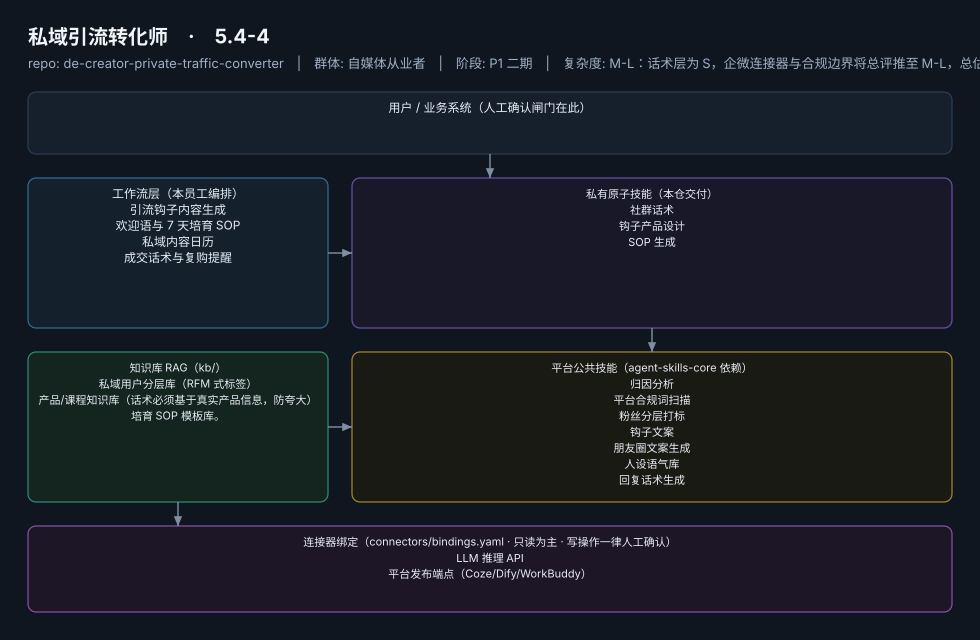
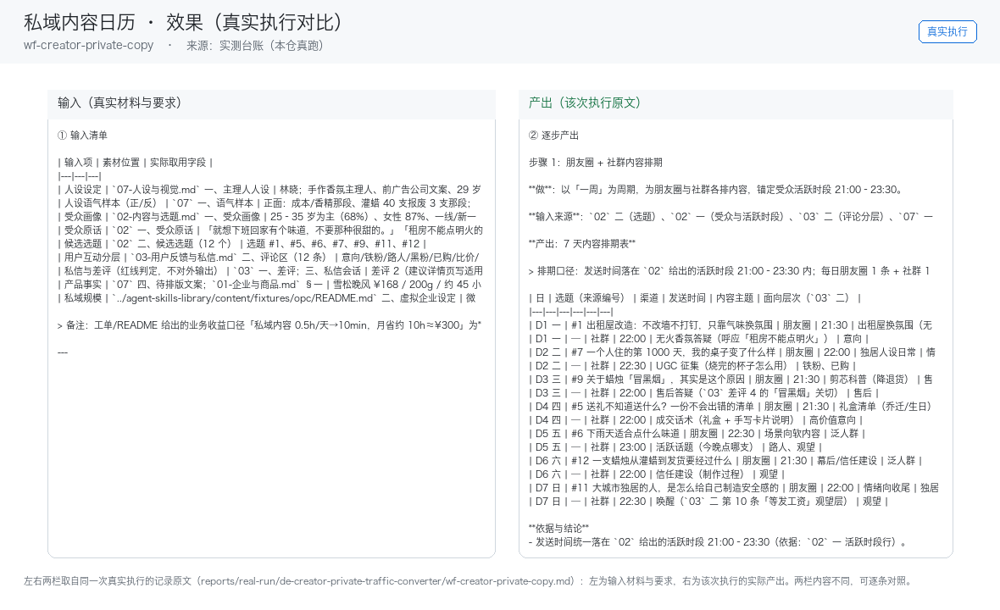

# 私域引流转化师

> 把公域粉丝合规沉淀为私域资产并培育成交的增收引擎
>
> **5.4-4**　·　自媒体从业者　·　阶段 P1 二期　·　
> 复杂度 M-L：话术层为 S，企微连接器与合规边界将总评推至 M-L，总估 10-15 人日　·　¥100-300/月（直接关联收入，知识付费创作者可承受，据 R2 调研；R5 调研交叉印证私域类为付费旗舰）　·　定义卡 5.4-4

## 演示（真实执行录播）


*真实执行回放（GIF 自动循环，非摆拍）· [▶ 观看完整版 MP4](workflows/wf-creator-private-copy/docs/images/08-demo-run.mp4) · 台账见 [`reports/real-run/wf-creator-private-copy.md`](reports/real-run/wf-creator-private-copy.md)*



## 效果（真实执行）



*上图为**真实效果对比**，不是示意图：左栏是输入材料与要求，右栏是该次执行的产出原文，
两栏取自同一次真实执行记录。*

- 完整台账：[`reports/real-run/wf-creator-private-copy.md`](reports/real-run/wf-creator-private-copy.md)
- 录屏与终端回放：[`workflows/wf-creator-private-copy/docs/images/`](workflows/wf-creator-private-copy/docs/images/)（`08-demo-run.gif` / `08-demo-run.mp4` / `04-terminal-run.png`）
- 使用示例：[`workflows/wf-creator-private-copy/docs/使用示例.md`](workflows/wf-creator-private-copy/docs/使用示例.md)
> 实测判定：**通过**　·　可用度 4/5　·　编造数字 0 处　·　红线命中 5 次 / 拦截 5 次


**一句话**：知识付费/带货类创作者（专栏转化率 5-8% 的存量群体，据 R2 调研）

---

## 这个数字员工解决什么问题

把公域粉丝合规沉淀为私域资产并培育成交的增收引擎

| 项 | 内容 |
|---|---|
| 服务对象 | 知识付费/带货类创作者（专栏转化率 5-8% 的存量群体，据 R2 调研） |
| 可量化目标 | 私域添加率提升（相对基线）；7 天培育 SOP 完成率；转化率从 <1% 基线（据 R2 调研）向 2-3% 区间爬坡 |
| 投入产出 | 知识付费市场约 2808.8 亿元（据 R2 调研，艾媒咨询）；转化率 +1pct 对月收入即数百元增量，ROI 以"增收"计远超创作类 |
| 需求依据 | D21、D26、D07 |
| 分发渠道 | GitHub（必备基础渠道）、小红书、淘宝、闲鱼（私域 SOP 模板类商品适配货架电商）、千问办公、腾讯WorkBuddy Skill市场 |

## 30 秒上手

```bash
git clone <本仓库地址> && cd de-creator-private-traffic-converter
pip install pyyaml
python3 tests/run.py            # 先跑一遍自检，确认环境与契约都对得上
```

试用（把 `<输入>` 换成本人真实材料）：

```text
请以「私域引流转化师」的身份，帮我跑「引流钩子内容生成」。
材料如下：<输入>
要求：只使用材料里出现过的数字，缺的写 <待填>；对外文案停在待确认状态。
```

详细接入见 [`docs/01-安装与接入.md`](docs/01-安装与接入.md)。

## 仓库结构

```text
de-creator-private-traffic-converter/
├── employee.md            # 人读定义卡（12 主字段 + 2 扩展组，由 employee.yaml 生成）
├── employee.yaml          # 机器契约（能力清单 + 依赖锁）
├── dependencies.yaml      # 对 core 的外部依赖（含版本）
├── persona/               # 运行提示词 / 边界 / KPI
├── skills/                # 私有原子技能（3 个）
├── spec-bindings/         # 有意不公共化能力的本地绑定声明（0 个）
├── workflows/             # 本员工工作流（4 条）
├── kb/                    # 知识库 RAG 契约
├── connectors/            # 连接器绑定（只读为主，写操作人工确认）
├── docs/                  # 六类发布文档
└── tests/                 # 自动化多场景测试
```

## 私有原子技能（3）

| 技能 | slug | 复杂度 | 阶段 | 成熟度 |
|---|---|---|---|---|
| `社群话术` | `community-group-copy` | S | P1 | 契约完备 |
| `钩子产品设计` | `hook-product-design` | S | P1 | 契约完备 |
| `SOP 生成` | `sop-generator` | S | P1 | 契约完备 |

## 平台公共技能依赖（7）

| 技能 | slug | 全平台复用员工数 |
|---|---|---|
| `归因分析` | `attribution-analysis` | 4 |
| `平台合规词扫描` | `compliance-word-scan` | 6 |
| `粉丝分层打标` | `fan-segment-tag` | 2 |
| `钩子文案` | `hook-copy` | 2 |
| `朋友圈文案生成` | `moments-copy-writer` | 2 |
| `人设语气库` | `persona-tone-lib` | 2 |
| `回复话术生成` | `reply-copy-generator` | 3 |

> 这些技能来自 `agent-skills-core@1.0.0`，本仓库**只引用不复制**。

## Spec 绑定层（0）

（无）

> 这一族能力**有意不公共化**（与外部平台接口强绑定）。本仓不存正文，
> 只留本地绑定声明与连接器配置。

## 工作流（4）

| 工作流 | slug | 触发 | 阶段 | 调用技能数 |
|---|---|---|---|---|
| `引流钩子内容生成` | `wf-creator-private-hook-design` | 人工（按活动） | P1 | 3 |
| `欢迎语与 7 天培育 SOP` | `wf-creator-private-nurture` | 事件（新粉加入） | P1 | 3 |
| `私域内容日历` | `wf-creator-private-copy` | 定时（每周） | P1 | 3 |
| `成交话术与复购提醒` | `wf-creator-private-conversion-track` | 事件（转化节点/沉睡唤醒） | P2 | 2 |

## 知识库与连接器

- 知识库语料：['私域用户分层库（RFM 式标签）', '产品/课程知识库（话术必须基于真实产品信息，防夸大）', '培育 SOP 模板库。']
- 连接器：LLM 推理 API、平台发布端点（Coze/Dify/WorkBuddy）

## 质量与验收

| 项 | 值 |
|---|---|
| 技能文件数 | 172 |
| 多场景用例数 | 221 |
| 用例通过 | 221 |
| 验收结论 | ✅ 通过 |

完整报告：[`docs/05-验收与测试.md`](docs/05-验收与测试.md)

## 许可

专有许可，详见 [`LICENSE`](LICENSE)。
